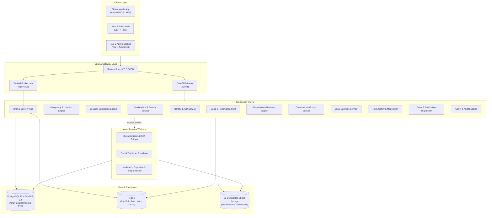

# BN NEAR — 10. System Architecture & Topology

**Order ID:** BN-NEAR-MASTER-001  
**Architecture Style:** Modular Monolith (Services decomposed by domain boundaries, ready for horizontal microservice extraction)  

---

## 1. High-Level Architecture Topology

---

## 2. Key Architecture Decisions
1. **Unified Storage Contract:** The core data layer leverages PostgreSQL 16 with PostGIS spatial extensions for exact boundary queries (`ST_Contains`, `ST_DWithin`). In testing environments or autonomous single-binary runs, the repository layer provides an interchangeable high-speed geospatial in-memory storage engine adhering to identical interfaces.
2. **WebSocket Sequence Guarantee:** Chat messages are assigned sequential monotonically increasing sequence numbers per conversation within a database transaction. Clients confirm receipt with ACKs, and reconnection protocols synchronize missed sequence ranges seamlessly.
3. **Reservation Row-Level Locking:** To eliminate double-booking or race conditions when multiple buyers attempt to reserve an item, the Deal Engine uses optimistic versioning (`version BIGINT`) and strict database transactions.
4. **Zero-Knowledge GPS Policy:** The system strictly separates internal raw coordinates (processed transiently for verification calculations and immediately discarded) from public catalog representations (which only store neighborhood IDs or randomized centroid offsets).
