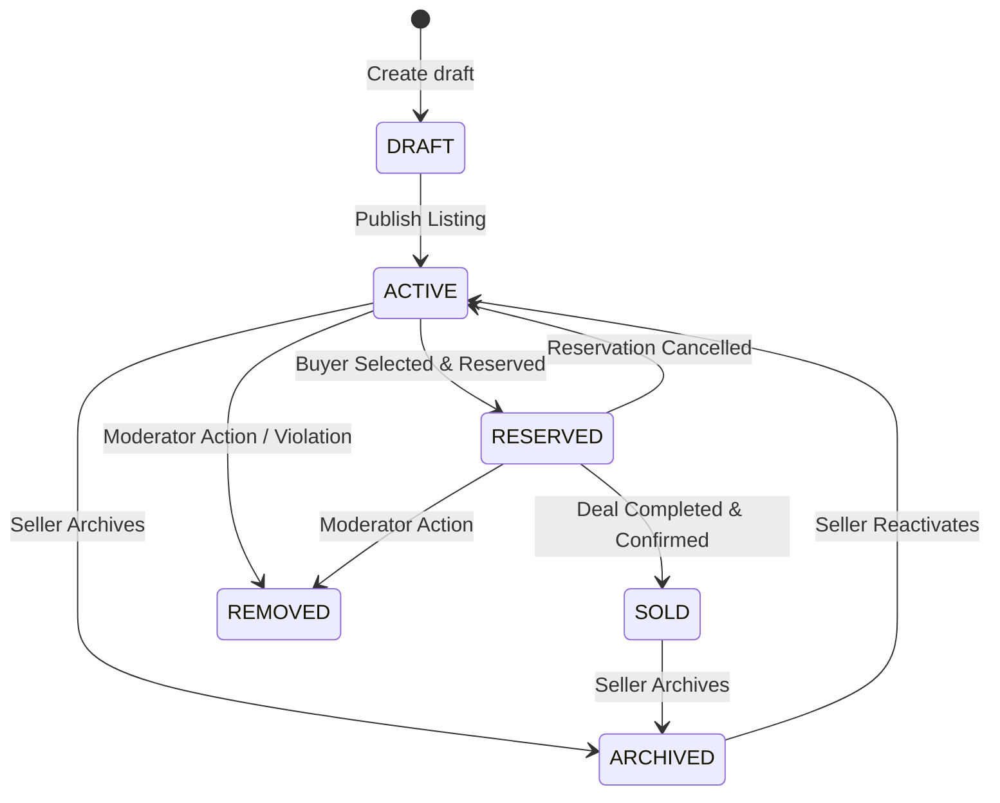

# BN NEAR — 17. Listing Lifecycle & State Machine

**Order ID:** BN-NEAR-MASTER-001  
**Module:** `services/api/internal/listings`  

---

## 1. Listing Lifecycle State Transitions

---

## 2. Transition Guard Rules
- **`DRAFT -> ACTIVE`**: Requires at least 1 image, valid title (>=2 chars), valid category, price_minor >= 0, and a verified neighborhood.
- **`ACTIVE -> RESERVED`**: Can ONLY be initiated by the listing's verified seller. Requires a valid buyer UUID with whom an active conversation exists. Sets `reserved_at = now()`.
- **`RESERVED -> ACTIVE`**: Can be triggered by seller (e.g., buyer cancelled/no-show) or by system if auto-expiry window triggers.
- **`RESERVED -> SOLD`**: Can ONLY transition when the associated deal record reaches `COMPLETED_CLAIMED` or `COMPLETED_CONFIRMED`. Sets `sold_at = now()`.
- **`ACTIVE/RESERVED -> REMOVED`**: Restricted to platform moderators or super administrators upon substantiated violation report.

