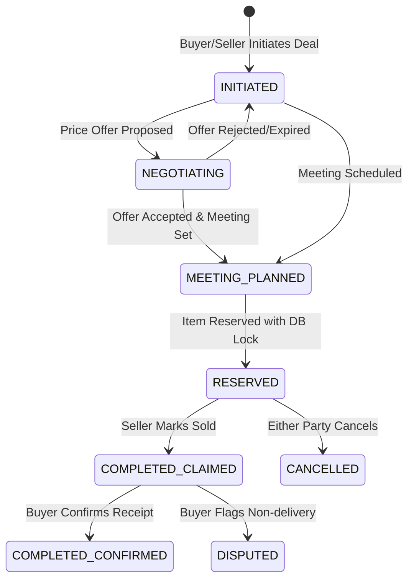

# BN NEAR — 18. Deal State Machine & Two-Phase Verification

**Order ID:** BN-NEAR-MASTER-001  
**Module:** `services/api/internal/deals`  

---

## 1. Deal State Transitions



---

## 2. Concurrency Control: Reservation Collision Lock
When multiple prospective buyers are chatting about the same listing, only **one buyer** can be placed in `RESERVED` status at any moment.

### Database Lock Strategy:
```sql
BEGIN;
-- Lock listing row for update
SELECT id, listing_status, version 
FROM listings 
WHERE id = :listing_id 
FOR UPDATE;

-- Ensure listing is currently ACTIVE
IF listing_status != 'ACTIVE' THEN
    ROLLBACK;
    RAISE EXCEPTION 'LISTING_NOT_AVAILABLE';
END IF;

-- Ensure no other active reservation exists
SELECT COUNT(*) FROM deals 
WHERE listing_id = :listing_id AND status = 'RESERVED';

-- Update listing state atomically
UPDATE listings 
SET listing_status = 'RESERVED', version = version + 1, reserved_at = NOW() 
WHERE id = :listing_id;

-- Insert or update deal record
INSERT INTO deals (id, listing_id, buyer_user_id, seller_user_id, status)
VALUES (:deal_id, :listing_id, :buyer_id, :seller_id, 'RESERVED');

COMMIT;
```

---

## 3. Two-Phase Completion & Review Unlocking
1. **Phase 1 (`COMPLETED_CLAIMED`):** The seller confirms handoff by tapping "Mark as Sold" in the chat screen. The buyer receives a prompt notification.
2. **Phase 2 (`COMPLETED_CONFIRMED`):** The buyer confirms that the item was received as described.
3. **Review Eligibility:** Only when the deal achieves `COMPLETED_CONFIRMED` (or after 48 hours without dispute from claim) do both parties unlock the ability to submit mutual reputation reviews. This eliminates fake review trading and spam ratings.

