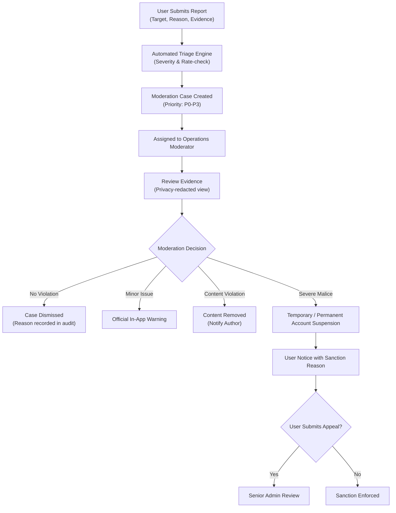

# BN NEAR — 20. Community Moderation & Safety Policy

**Order ID:** BN-NEAR-MASTER-001  
**Module:** `services/api/internal/moderation`  

---

## 1. Universal Reporting System
Users can flag inappropriate content or behavior from any platform surface:
- **Listing Report:** Counterfeit items, prohibited weapons/drugs, fraud, price abuse.
- **User Profile Report:** Impersonation, harassment, scam behavior.
- **Chat Conversation Report:** Toxic language, stalking, fraudulent off-platform payment links.
- **Community Post/Comment Report:** Hate speech, doxxing / personal privacy leaks, spam advertising.

---

## 2. Moderation Workflow

---

## 3. Privacy-Preserving Chat Evidence Review
Moderators CANNOT browse private chats freely. When a user reports a chat, the client submits a snapshot containing up to 10 surrounding messages as cryptographic evidence. This snapshot is sealed into the moderation case record and accessible only to authorized moderators with explicit audit logging of every view action.
