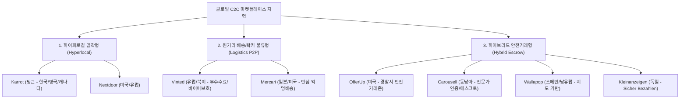
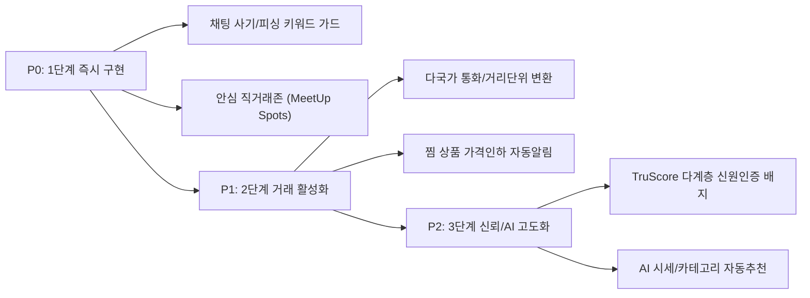

# BOOKING NETWORK CO., LTD.
# BN NEAR — 글로벌 중고거래 & 하이퍼로컬 플랫폼 벤치마킹 및 기능 구현 보고서
**보고서 ID:** BN-REP-BENCHMARK-2026-001  
**발행처:** Booking Network Co., Ltd. — 기술전략 및 프로덕트 오너 본부  
**수신:** 최고 Product Owner (Chief PO)  
**분석 대상:** 글로벌 8대 C2C/하이퍼로컬 플랫폼 (Karrot, OfferUp, Mercari, Vinted, Nextdoor, Carousell, Wallapop, Kleinanzeigen)  
**작성일자:** 2026-10-27  

---

## 1. 글로벌 중고거래 플랫폼 지형도 및 비즈니스 모델 비교

전 세계 C2C 및 지역 기반 플랫폼은 지리적 특성(도시 인구밀도 vs 교외 자동차 통근 문화), 물류 인프라, 사기 범죄율에 따라 3가지 주요 유형으로 분화되어 있습니다.

---

## 2. 글로벌 8대 플랫폼 심층 벤치마킹 분석

| 플랫폼 | 핵심 진출 권역 | 거래 방식 | 신뢰/검증 메커니즘 | 독점적 혁신 기능 (Killer Feature) | 수익화 모델 |
|---|---|---|---|---|---|
| **Karrot** (당근) | 한국, 영국, 캐나다, 일본 | 100% 로컬 직거래 (반경 1~10km GPS 검증) | 매너온도(36.5°C 기준), GPS 동네 인증 2회 필수 | • 동네생활 커뮤니티 (Q&A, 분실물, 정보공유) • 당근페이(무료 송금) • 동네가게 비즈니스 프로필 | 로컬 소상공인 타깃 하이퍼로컬 디스플레이 광고 |
| **OfferUp** | 미국 (전역) | 로컬 직거래 + 미국 내 택배 배송 | TruYou (정부 발급 신분증 + 얼굴 셀피 검증) | • **Community MeetUp Spots** (경찰서/관공서 24시간 CCTV 안심거래존) • 채팅 내 즉시 가격 제안(Make Offer) | 프로모션 상단 노출(Bump), 배송 거래 시 수수료 |
| **Mercari** (メルカリ) | 일본, 미국 | 배송 중심 (편의점/무인택배함 연동) + 퀵배송 | 100% 사전 결제 예치(에스크로), 상호 평점 | • **익명 배송 (Anonymous Shipping)**: 상대방 주소/이름 미노출 • **Mercari Local**: 우버/도어대시 연계 대형가구 당일 픽업 • **가격 인하 프로모션(Promote)**: 5% 할인 시 찜한 사용자 전체 자동 푸시 | 판매 수수료 (일본 10%), 출금 수수료 |
| **Vinted** | 유럽 (프랑스, 영국, 독일, 스페인 등) | P2P 택배 및 락커(InPost, Mondial) | Buyer Protection Pro, 가품 방지 전수 검수 | • **판매자 수수료 0%** (구매자가 고정비+5% 부담) • **번들 할인(Bundle Discount)**: 동일 판매자 물품 2~5개 묶음 구매 시 10~30% 자동 할인 | 구매자 보호 수수료, 옷장 스포트라이트 광고 |
| **Nextdoor** | 미국, 영국, 캐나다, 호주, 유럽 | 이웃 소셜 커뮤니티 + 벼룩시장(For Sale) | 우편 엽서 코드 발송, 신용카드 청구지 주소 일치 검증 | • 우편물 실주소 인증 기반 100% 실거주자 폐쇄망 • 공공기관/경찰서 긴급 재난 안전 브리핑 연동 | 공공기관 공지 스폰서십, 로컬 서비스 광고 |
| **Carousell** | 동남아 (싱가포르, 홍콩, 말레이시아, 대만) | 로컬 직거래 + 동남아 전역 배송 | SingPass(국가 디지털 신원), Carousell Certified | • **AI 자동 리스팅**: 사진 1장 촬영 시 품목, 브랜드, 카테고리, 적정 시세 자동 추천 • **Carousell Certified**: 명품, 전자제품 플랫폼 공식 검수 후 보증 판매 | 결제 에스크로 수수료, 범프/하이라이트 광고 |
| **Wallapop** | 스페인, 이탈리아, 포르투갈 | 지도 기반 로컬 탐색 + Wallapop Envíos | 월렛 결제 에스크로, 프로필 인증 배지 | • **실시간 지리 지도 인터페이스**: 내 주변 상품 핀포인트 표시 • 거리 순 정렬 (200m 이내, 1km 이내 등) | 자체 배송망(Wallapop Envíos) 수수료 |
| **Kleinanzeigen** | 독일, 중부 유럽 | 로컬 직거래 + 독일 내 배송 | Sicher Bezahlen (Adyen 에스크로 안전결제) | • **외부 채팅/피싱 자동차단 경고**: 채팅창 내 WhatsApp, SMS 링크 감지 시 즉시 경고 배너 출력 | 안전결제 수수료, 비즈니스 리스팅 광고 |

---

## 3. BN NEAR 플랫폼 적용 필수 고도화 기능 명세

현재 BN NEAR는 **PostGIS 폴리곤 동네 인증, 1:1 실시간 웹소켓 채팅(시퀀스 보장), 거래 예약 행 잠금(409 Conflict), 2단계 거래 완료 FSM, 매너온도, 감사 추적 관리자**를 갖추고 있습니다.

글로벌 경쟁력과 실제 사용자 거래 안전을 극대화하기 위해 다음 **6대 핵심 기능**을 추가 구현해야 합니다.

### [기능 1] 안심 직거래 존 (Community MeetUp Spots)
- **벤치마크:** OfferUp
- **목적:** 야간이나 인적이 드문 곳에서의 직거래로 인한 강도, 분실, 불안감 완전 해소
- **구현 내용:**
  - 동네별(Neighborhood) 공공 CCTV 운영 구역, 지구대/파출소 앞, 지하철 역사 내 고객센터, 24시간 편의점을 '공식 안심거래존'으로 등록
  - 채팅 내 `거래 약속 잡기(Schedule Meeting)` 시 [안심직거래 장소 선택] 팝업 제공
  - 상대방에게 장소 지도 좌표와 "CCTV 24시간 녹화 구역" 배지 공유

### [기능 2] 사기 의심 키워드 & 피싱 실시간 탐지 엔진 (Chat Anti-Phishing Guard)
- **벤치마크:** Kleinanzeigen, Carousell
- **목적:** 카카오톡, 왓챠, 텔레그램, 외부 피싱 결제 URL로 유도하는 사기 수법 원천 차단
- **구현 내용:**
  - 웹소켓 메시지 전송 시 서버 미들웨어에서 정규식 기반 실시간 위험도 스코어링
  - 탐지 대상: `kakao`, `open.kakao`, `t.me`, `whatsapp`, `010-`, 상품권 핀번호 유도, 외부 송금 링크
  - 탐지 시 즉시 상대방 채팅창 상단에 붉은색 경고 배너 출력:
    > "⚠️ 주의: 외부 메신저나 안전결제 사칭 링크로 유도하는 행위는 사기 위험이 매우 높습니다. 플랫폼 내에서만 대화하세요."

### [기능 3] 다국가 통화 & 거리 단위 로컬라이제이션 (Multi-Currency & Units)
- **벤치마크:** Vinted, Wallapop
- **목적:** 한국(KRW, 원)뿐 아니라 글로벌 도시(미국 USD, 일본 JPY, 유럽 EUR, 싱가포르 SGD) 동시 지원
- **구현 내용:**
  - 국가(Country)별 ISO 통화 코드, 화폐 기호, 소수점 자릿수(minor unit) 동적 렌더링
  - 거리 단위: 대한민국/유럽은 `km`, 미국/영국은 `miles` 자동 변환 표기

### [기능 4] 찜 가격 인하 자동 알림 (Promote to Likers & Price Drop Alerts)
- **벤치마크:** Mercari
- **목적:** 등록된 지 오래된 상품의 재거래 성사율(Liquidity) 극대화
- **구현 내용:**
  - 판매자가 상품 가격을 기존 대비 5% 이상 인하 수정 시, 해당 상품을 찜(`favorites`)한 모든 관심 사용자에게 실시간 웹소켓/푸시 알림 발송
  - 알림 메시지: `"[가격인하] 관심 상품 '아이패드 에어 5세대'의 가격이 550,000원에서 500,000원으로 인하되었습니다!"`

### [기능 5] 다계층 사용자 신원 검증 배지 (TruScore Multi-Tier Identity)
- **벤치마크:** OfferUp (TruYou), Nextdoor
- **목적:** 익명성에 숨은 사기 계정 억제 및 거래 신뢰도 등급화
- **구현 내용:**
  - **Tier 1 (기본):** 이메일/전화번호 인증 완료
  - **Tier 2 (로컬 인증):** GPS 기반 동네 위치 인증 완료
  - **Tier 3 (신원 인증):** 사업자등록증 또는 정부 신분증(주민등록증/여권 등) 검증 완료 마크
  - 사용자 프로필 및 채팅 프로필에 인증 배지 시각화

### [기능 6] AI 기반 카테고리 & 시세 자동 추천 (Smart Listing Assistant)
- **벤치마크:** Carousell Group AI
- **목적:** 판매글 작성 이탈률 최소화 및 10초 내 초간편 등록
- **구현 내용:**
  - 판매자가 제목(예: "맥북 프로 14인치 M3 16G")을 입력하면, AI 시맨틱 엔진이 적합 카테고리(`디지털기기 > 노트북`)를 자동 선택
  - 해당 동네 및 인근 지역의 최근 3개월간 동일 품목 평균 거래 체결 가격 범위 안내

---

## 4. BN NEAR 구현 우선순위 로드맵

---

## 5. 결론 및 PO 승인 요청 사항

본 벤치마킹 조사를 통해 확인된 바와 같이, 당근(Karrot)의 **지역 커뮤니티성**, OfferUp의 **안심 직거래존(MeetUp Spots)**, Mercari의 **가격 인하 자동 프로모션**, Kleinanzeigen의 **인앱 사기 방지 가드**를 융합하는 것이 글로벌 시장에서 가장 강력하고 독립적인 플랫폼 경쟁력을 확보하는 길입니다.

우선순위 **P0 과제**인 `채팅 사기/피싱 키워드 실시간 탐지 가드` 및 `안심 직거래존(MeetUp Spots) 스케줄링 연동`부터 백엔드 및 클라이언트에 즉각 반영을 추진하고자 합니다.
